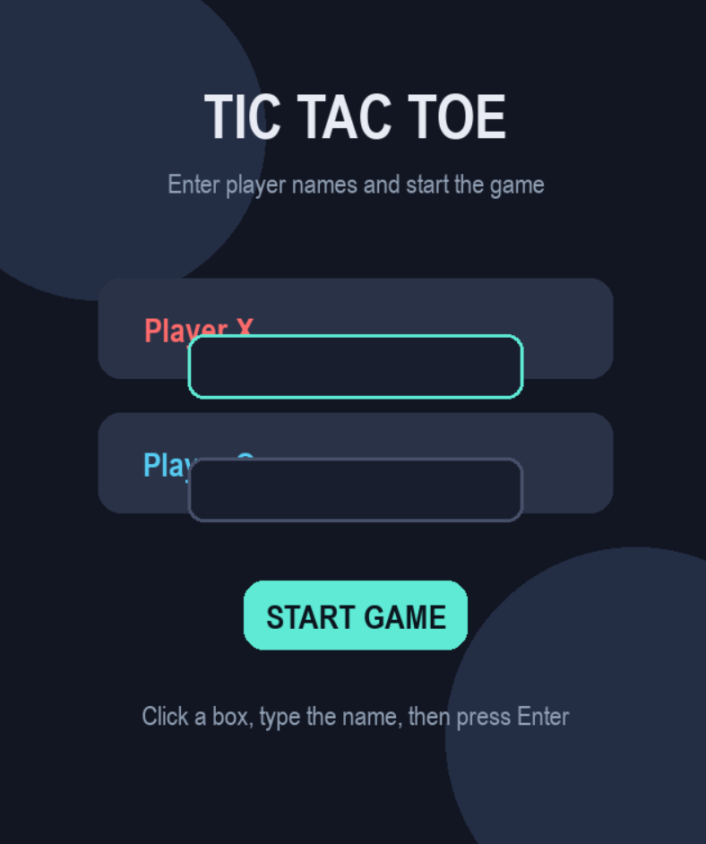
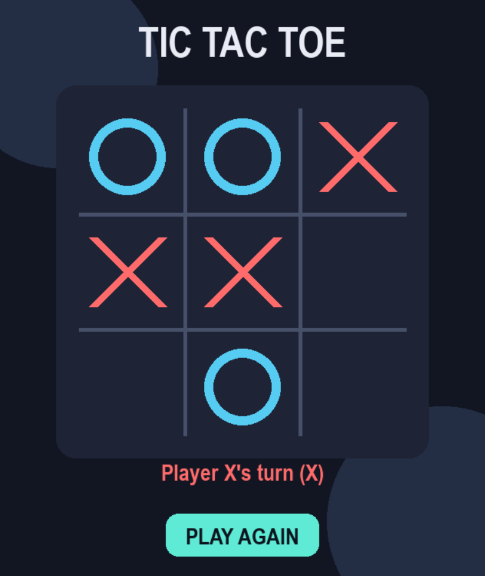
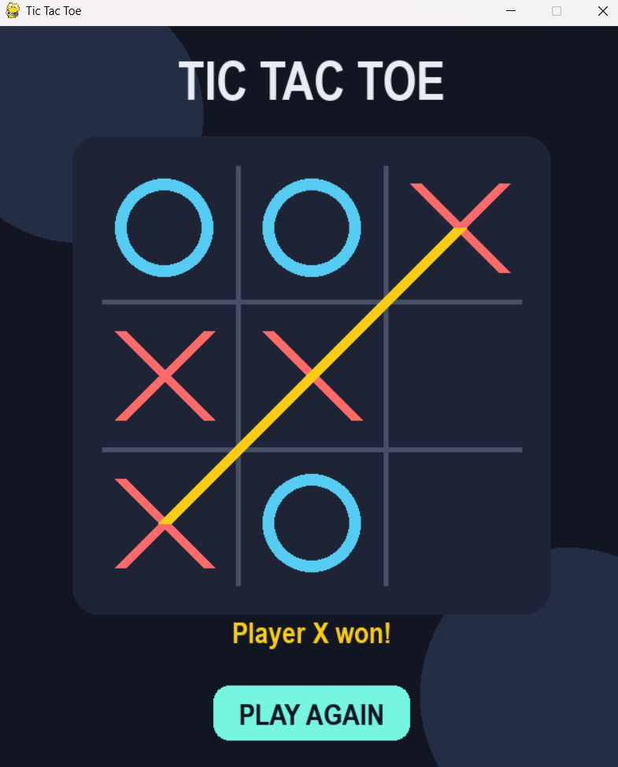

# 🎮 Tic Tac Toe — Python & Pygame

A modern, colorful **Tic Tac Toe (X and O)** game built with **Python** and **Pygame**.

Two players can enter their names, play turn by turn, and see the winner’s name at the end — for example: **`Ali won!`**

## ✨ Features

- 🎨 Modern dark-themed interface
- 👤 Player name input before starting the game
- ❌ Player X and ⭕ Player O
- 🖱️ Easy mouse-click gameplay
- 🏆 Automatic winner detection
- 🟡 Highlighted winning line
- 🤝 Draw detection
- 🔁 Play Again button
- 🇬🇧 Fully English user interface

## 🖼️ Game Preview

### Start Screen

Players enter their names before the game begins.

<p align="center">
  
</p>

### Gameplay

Players take turns placing **X** and **O** on the board.

<p align="center">
  
</p>

### Winner Screen

When a player wins, their name is displayed clearly.

<p align="center">
  
</p>

## 🚀 Getting Started

### Prerequisites

Make sure you have Python installed on your system.

- Python 3.8 or higher
- Pygame

### Installation

1. Clone the repository:

```bash
git clone [https://github.com/your-username/tic-tac-toe.git](https://github.com/your-username/tic-tac-toe.git)
cd tic-tac-toe
```

2. Install the required package:

```bash
pip install pygame
```

3. Run the game:

```bash
python tic_tac_toe.py
```

## 🎮 How to Play

1. Run the game.
2. Enter the name of **Player X**.
3. Enter the name of **Player O**.
4. Click **START GAME**.
5. Click any empty square to place your symbol.
6. The first player to align three symbols horizontally, vertically, or diagonally wins.
7. If all squares are filled without a winner, the game ends in a draw.

## 🏆 Winner Message

When a player wins, the game displays their name:

```text
Ali won!
```

If the game ends without a winner:

```text
It's a draw!
```

## 📁 Project Structure

```text
tic-tac-toe/
│
├── tic_tac_toe.py        # Main game file
├── README.md             # Project documentation
└── assets/
    ├── start-screen.png   # Start screen screenshot
    ├── gameplay.png       # Gameplay screenshot
    └── winner.png         # Winner screen screenshot
```

## 🛠️ Technologies Used

| Technology | Purpose |
|---|---|
| Python | Main programming language |
| Pygame | Game window, graphics, and user interaction |
| Git & GitHub | Version control and project hosting |

## 🤝 Contributing

Contributions are welcome!

1. Fork the repository
2. Create a new branch:
   ```bash
   git checkout -b feature-name
   ```
3. Commit your changes:
   ```bash
   git commit -m "Add a new feature"
   ```
4. Push to the branch:
   ```bash
   git push origin feature-name
   ```
5. Open a Pull Request

## 📄 License

This project is licensed under the **MIT License**.

---

<p align="center">
  Made with ❤️ using Python and Pygame
</p>